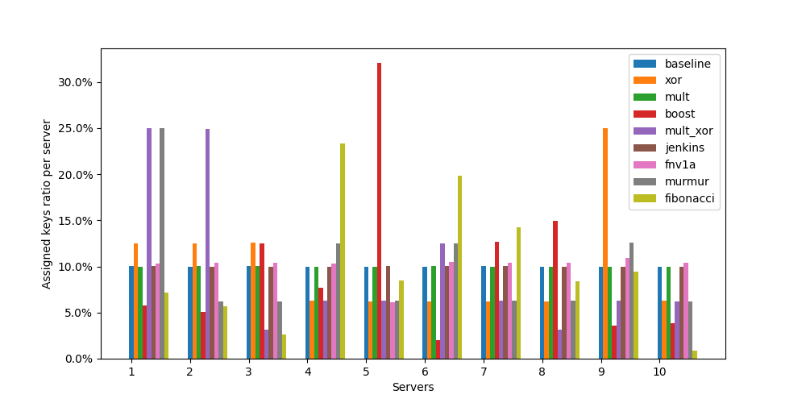
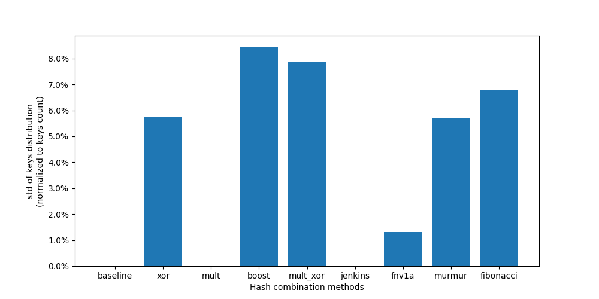
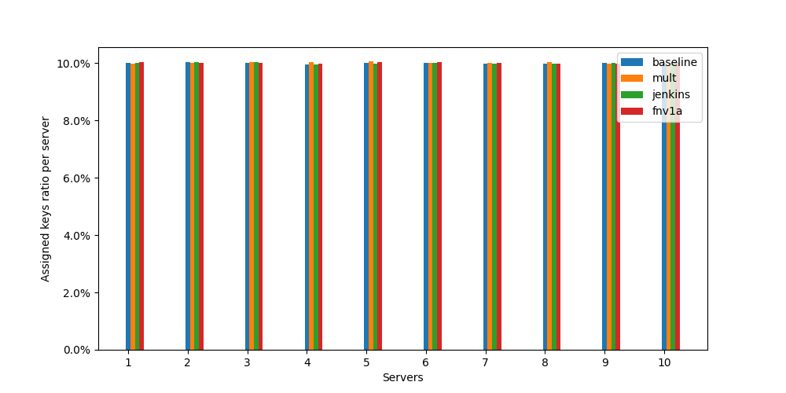
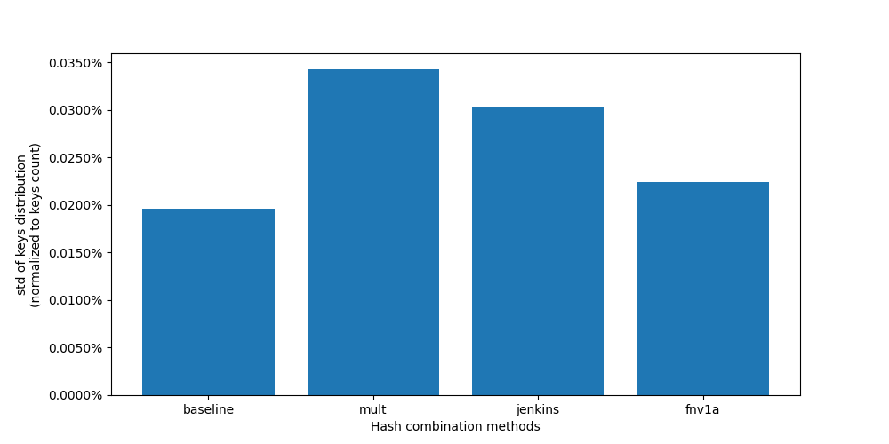
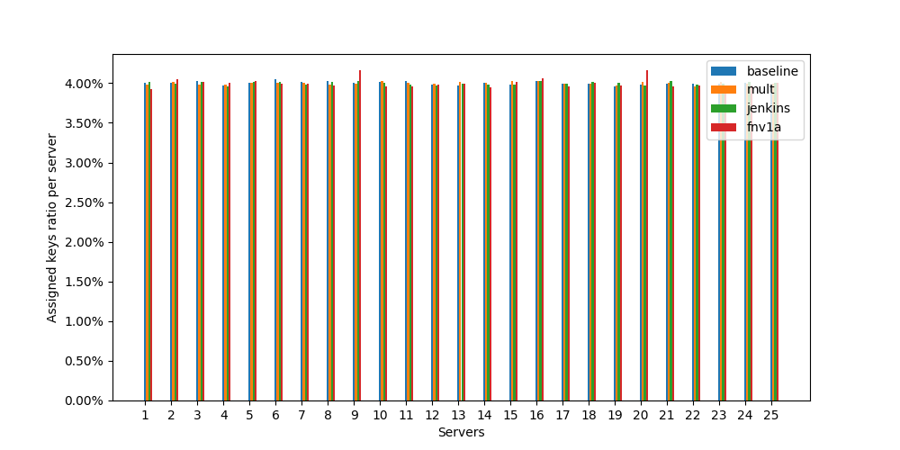
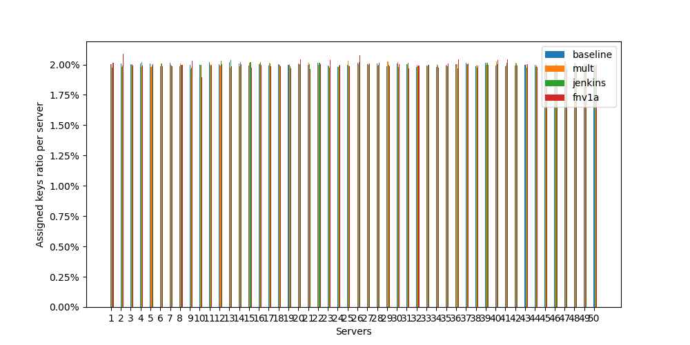

# Introduction

Data distribution is one of the toughest challenges we face in distributed systems. The field has developed several key approaches over the last 30 years. Most developers are familiar with consistent hashing, but I want to talk about a different technique - rendezvous hashing. It's been gaining traction lately because it's both efficient and easier to implement. What many don't realize is that consistent hashing is actually a specialized case of rendezvous hashing. We can find rendezvous hashing in action across major tech platforms today - GitHub uses it in their load balancer, Twitter has it in their EventBus pub/sub platform, and it's a key component of Apache Ignite's distributed database.

Formally Rendezvous hashing (also called highest random weight or HRW hashing) is an algorithm that helps clients agree on *K* choices from a set of *N* possible options. Think of it like this - when clients need to decide which servers should handle which objects, rendezvous hashing provides that distributed agreement. The technique came from David Thaler and Chinya Ravishankar at the University of Michigan back in 1996.

Imagine you're choosing a server to store a file. Instead of just picking the first available one or using a simple round-robin approach, rendezvous hashing has each server "compete" for each piece of data. Here's how: for every data item, we calculate a score by combining the data's key with each server's identifier through a hash function. The server that gets the highest score (or top *K* servers with highest scores) wins and gets to handle that data.

What makes this approach powerful is its stability when servers come and go. If a server fails, only the data that was "won" by that specific server needs to be redistributed. Similarly, when we add a new server, it only takes over the data items where it scores higher than existing servers. Most data stays put, exactly where it was. This minimal redistribution is crucial for maintaining system performance, especially under heavy loads.

The real beauty of rendezvous hashing lies in its decentralized nature. Every client running this algorithm will make the same decisions independently, without any need for coordination. As long as they use the same hash function, they'll all agree on which server should handle which data. This property makes it particularly valuable in distributed systems where synchronization is expensive or impractical.

Read more on [Wikipedia](https://en.wikipedia.org/wiki/Rendezvous_hashing)

# Problem

When I first started discovering rendezvous hashing, one particular challenge kept me up at night: the computational complexity of calculating N hashes. For each incoming request, we need to compute N separate hash values - one for each combination of the key with each server identifier. While rendezvous hashing doesn't mandate any specific hashing algorithm (it only requires one that provides good uniform distribution), MurmurHash has become the de-facto standard. MurmurHash3 comes in 32-bit, 64-bit, and 128-bit variants, and while it's blazingly fast, the CPU time adds up quickly in high-load scenarios.

Let me illustrate with a real-world example. In C#, calculating a MurmurHash for two GUIDs as strings (a common scenario in production systems) takes about 92 nanoseconds. Now, imagine a system with 10 servers handling 1,000 requests per second each - that adds up to 1 millisecond of pure hashing computation. In high-performance systems, every millisecond counts.

What's particularly frustrating is that most articles discussing rendezvous hashing gloss over this performance aspect. Some propose solutions but don't explain why they work, while others suggest using hierarchical systems that seem unnecessarily complex to implement in many modern circumstances (unless you're building a globally distributed DHT like BitTorrent or Kademlia). This led me to wonder: could we find a more elegant approach?

# Research

Idea: instead of recalculating hashes for server IDs over and over, why not precalculate them once? We'd store these server hashes, then for each key that comes in, we just need to calculate its hash once. The tricky part is combining these two hashes - we need some fast mathematical operations that'll mix our key's hash with each server's hash while keeping the good distribution properties that MurmurHash gives us.

We can find lots of ways to combine hashes out there. Some people got clever and borrowed ideas from existing hash functions, while others developed their approaches over time until they were solid enough to ship in production systems.

I wanted to test this properly, so I did my homework - dug through papers, checked what others were doing, and of course bounced some ideas off Claude/GPT. To keep things manageable, I stuck to 32-bit MurmurHash and came up with eight different ways we could combine these hashes.
1. Simple XOR: `h1 ^ h1`.
2. Simple multiplication: `(h1 * h2) ^ 0xFFFFFFFF`
3. Multiply and XOR: `(h1*prime1 ^ h2*prime2) ^ 0xFFFFFFFF`
4. Hash combiner from C++ boost library (`hash_combine`)
5. Hash combiner inspired by Jenkins hash function (see attachments)
5. Hash combiner inspired by FNV-1a hash function (see attachments)
6. Hash combiner inspired by Murmur hash function (see attachments)
7. Hash combiner that uses golden ratio multiplication (see attachments)

Of course, I used a naive MurmurHash implementation as my baseline to compare against these approaches. The testing setup was pretty straightforward: I generated three different sets of server IDs (5, 10, and 20 servers) using GUIDs, then tested them against a million different keys. For the keys, I wanted to simulate real-world scenarios, so I used two different formats. First were simple GUIDs - you'd typically see these when using rendezvous hashing in databases to distribute records. The second format followed the pattern `users:<number>` and `orders:<number>` - the kind of keys you'd commonly find in distributed caching services like Redis or Memcached.

The first run showed me following:





As we can see from these charts, not all hash combining methods are created equal. The first chart shows key distribution across servers, where ideally we want a uniform 10% distribution per server. Most methods fluctuate around this target, but some (like `boost` and `xor`-centric) show concerning spikes, indicating poor distribution. The second chart gives us a clearer picture by showing the standard deviation of key distribution - lower values mean more uniform distribution. Here, simple multiplication (`mult`) and baseline approach show remarkably low deviation, suggesting they provide the most balanced distribution. The `FNV1a` method also performs well, while `boost` and `mult_xor` show significantly higher deviation.

Let's have a look more closely to these 3 combiners: `mult`, `jenkins` and `FNV-1a` (comment others and run again).





Looking at the "zoomed charts", all three methods maintain a good even spread of keys across our servers. The naive MurmurHash serves as our baseline and shows the best uniformity, with other methods coming in close despite showing slightly higher variation. The results staying consistent across multiple test runs.

And as a bonus, distributions charts for 25 and 50 servers attached to the end of the article.

# Conclusion

Three hash combination methods (simple multiplication, `Jenkins`, and `FNV-1a`) provide excellent distribution quality comparable to the baseline approach. However, when we look at computational efficiency, simple multiplication looks as the clear winner.

Let's put some concrete numbers behind this. Running benchmarks in C#, calculating 10 "full" hashes (the baseline approach) takes around *1605.5 nanoseconds*. In contrast, optimized approach - calculating one key hash and combining it with 10 pre-calculated server hashes using multiplication - takes only *125.9 nanoseconds*. That's a ~*12x performance improvement* (including 25x less memory usage) while maintaining the same quality of distribution.

# Attachments

## Distributions Charts





## Jupyter Notebook Export

```python
SERVERS_COUNT = 10
KEYS_COUNT = 1000000
```


```python
import numpy as np
import random

from collections.abc import Callable
from dataclasses import dataclass
from mmh3 import hash as murmurhash
from uuid import uuid4

MURMUR_SERVERS_SEED = 165233
MURMUR_KEY_SEED = 845219
```


```python
@dataclass
class Server:
    id: str
    hash: int

def generate_server() -> Server:
    server_id = str(uuid4())
    server_hash = murmurhash(server_id, seed=MURMUR_SERVERS_SEED, signed=False)
    return Server(id=server_id, hash=server_hash)

servers = [generate_server() for _ in range(SERVERS_COUNT)]
servers
```


```python
@dataclass
class Key:
    value: str
    hash: int

def generate_key(value) -> Key:
    h = murmurhash(value, seed=MURMUR_KEY_SEED, signed=False)
    return Key(value=value, hash=h)
```


```python
PRIME_1 = 647935811
PRIME_2 = 738385777
PRIME_3 = 559072043
UINT_MASK = 0xFFFFFFFF

def generate_hash_baseline(server: Server, key: Key) -> int:
    return murmurhash(f'{server.id}{key.value}', seed=MURMUR_KEY_SEED, signed=False)

def generate_hash_xor(server: Server, key: Key) -> int:
    return server.hash ^ key.hash

def generate_hash_mult(server: Server, key: Key) -> int:
    return (server.hash * key.hash) & UINT_MASK

def generate_hash_boost(server: Server, key: Key) -> int:
    """
    Implementation inspired by Boost's hash_combine function.
    Uses golden ratio and bit operations for good distribution.
    """
    return (server.hash ^ (key.hash + 0x9e3779b9 + (server.hash << 6) + (server.hash >> 2))) & UINT_MASK

def generate_hash_multiply_xor(server: Server, key: Key) -> int:
    """
    Combines hashes using multiplication and XOR.
    The large prime helps with distribution.
    """
    return ((server.hash * PRIME_1) ^ key.hash) & UINT_MASK

def generate_hash_jenkins(server: Server, key: Key) -> int:
    """
    Adaptation of Jenkins hash for combining two hashes.
    Known for good avalanche behavior.
    """
    hash = server.hash
    hash += key.hash
    hash += (hash << 10)
    hash ^= (hash >> 6)
    hash += (hash << 3)
    hash ^= (hash >> 11)
    hash += (hash << 15)
    return hash & UINT_MASK

def generate_hash_fnv1a(server: Server, key: Key) -> int:
    """
    Inspired by FNV-1a hash function.
    Uses FNV prime for good distribution.
    """
    fnv_prime = PRIME_1
    h1 = server.hash
    h2 = key.hash

    hash = h1
    hash ^= h2 & 0xFF
    hash = (hash * fnv_prime) & UINT_MASK
    hash ^= (h2 >> 8) & 0xFF
    hash = (hash * fnv_prime) & UINT_MASK
    hash ^= (h2 >> 16) & 0xFF
    hash = (hash * fnv_prime) & UINT_MASK
    hash ^= (h2 >> 24) & 0xFF
    hash = (hash * fnv_prime) & UINT_MASK
    return hash

def generate_hash_murmur(server: Server, key: Key) -> int:
    """
    Inspired by MurmurHash mixing function.
    Good distribution through multiplication and rotations.
    """
    h1 = server.hash
    h2 = key.hash

    c1 = 0xcc9e2d51
    c2 = 0x1b873593

    h1 = (h1 * c1) & UINT_MASK
    h1 = ((h1 << 15) | (h1 >> 17)) & UINT_MASK
    h1 = (h1 * c2) & UINT_MASK

    h2 = (h2 * c1) & UINT_MASK
    h2 = ((h2 << 15) | (h2 >> 17)) & UINT_MASK
    h2 = (h2 * c2) & UINT_MASK

    return (h1 ^ h2) & UINT_MASK

def generate_hash_fibonacci(server: Server, key: Key) -> int:
    """
    Uses golden ratio multiplication for combining hashes.
    Known for good distribution properties.
    """
    golden_ratio_a = 2654435769
    golden_ratio_b = 1640531526
    return (server.hash * golden_ratio_a + key.hash * golden_ratio_b) & UINT_MASK
```


```python
@dataclass
class Test:
    name: str
    generator: Callable[Server, Key]
    buckets: [int]

    def __init__(self, name, generator):
        self.name = name
        self.generator = generator
        self.buckets = [0 for _ in range(SERVERS_COUNT)]

    def add(self, key: Key) -> None:
        hashes = [self.generator(server, key) for server in servers]
        hashes_max_index = np.argmax(hashes)
        self.buckets[hashes_max_index] += 1

    def clear(self):
        self.buckets = [0 for _ in range(SERVERS_COUNT)]

tests = [
    Test('baseline', generate_hash_baseline),
    # Test('xor', generate_hash_xor),
    Test('mult', generate_hash_mult),
    # Test('boost', generate_hash_boost),
    # Test('mult_xor', generate_hash_multiply_xor),
    Test('jenkins', generate_hash_jenkins),
    Test('fnv1a', generate_hash_fnv1a),
    # Test('murmur', generate_hash_murmur),
    # Test('fibonacci', generate_hash_fibonacci),
]
tests
```


```python
KEYS_PREFIXES = ['users', 'orders', 'products']

for i in range(KEYS_COUNT):
    # key_prefix = random.choice(KEYS_PREFIXES)
    # key_value = f'{key_prefix}:{i + 1000}'
    key_value = str(uuid4())
    key = generate_key(key_value)

    for test in tests:
        test.add(key)

tests
```


```python
import matplotlib.pyplot as plt
import matplotlib.ticker as mtick

f, ax = plt.subplots(figsize=(10, 5))

ax.set_xticks([i+1 for i in range(SERVERS_COUNT)])
ax.yaxis.set_major_formatter(mtick.PercentFormatter())

bar_width = 0.075

for i in range(len(tests)):
    test = tests[i]
    ax.bar([j+1 + i*bar_width for j in range(SERVERS_COUNT)],
           [test.buckets[j] / KEYS_COUNT * 100 for j in range(len(test.buckets))],
           width=bar_width,
           label=tests[i].name)

f.gca().set_xlabel('Servers')
f.gca().set_ylabel('Assigned keys ratio per server')
f.gca().legend()

f.savefig("keys-distribution.png")
```


```python
import scipy.stats as stats

std_x = [t.name for t in tests]
std_y = [np.std(t.buckets) / KEYS_COUNT * 100 for t in tests]

f, ax = plt.subplots(figsize=(10, 5))

ax.yaxis.set_major_formatter(mtick.PercentFormatter())
ax.bar(std_x, std_y)

f.gca().set_xlabel('Hash combination methods')
f.gca().set_ylabel('std of keys distribution\n(normalized to keys count)')

f.savefig("std-distribution.png")
```


```python
def print_stat(dist, name):
    print(f'### {name} ###')
    print(f'Mean: {np.mean(dist)}')
    print(f'Std: {np.std(dist)}')
    print(f'Mode: {stats.mode(dist)}')
    print(f'Skew: {stats.skew(dist)}')
    print()

for test in tests:
    print_stat(test.buckets, test.name)
```


```python
TEST_TRIES = 10
errors = [0 for _ in tests]
for i in range(TEST_TRIES):
    for test in tests:
        test.clear()

    for _ in range(KEYS_COUNT):
        # key_prefix = random.choice(KEYS_PREFIXES)
        # key_value = f'{key_prefix}:{random.randint(KEY_MIN_VALUE, KEY_MAX_VALUE)}'
        key_value = str(uuid4())
        ey = generate_key(key_value)

        for test in tests:
            test.add(key)

    for j in range(len(tests)):
        errors[j] += np.std(tests[j].buckets)/KEYS_COUNT

for i in range(len(errors)):
    errors[i] /= TEST_TRIES
```


```python
f, ax = plt.subplots()
ax.bar([t.name for t in tests], errors)

f.gca().set_xlabel('hash methods')
f.gca().set_ylabel('error of keys')
```

## C# Benchmark Results

| Method   | Mean       | Error    | StdDev   | Gen0   | Allocated |
|--------- |-----------:|---------:|---------:|-------:|----------:|
| Baseline | 1,605.5 ns | 30.97 ns | 30.41 ns | 0.7839 |    3280 B |
| Combined |   125.9 ns |  1.46 ns |  1.29 ns | 0.0305 |     128 B |
