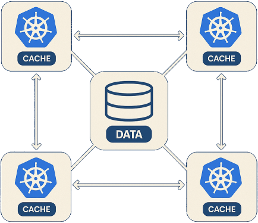

# Introduction

Imagine your service running across a dozen (or even few dozens) containers in Kubernetes, each maintaining its own local memory cache to reduce database load. While this setup is simple, it leads to inefficiencies: the same data is duplicated across multiple nodes, and cache entries are frequently evicted due to limited memory, leading to higher cache miss rates. This not only wastes valuable memory but also undermines cache effectiveness. Alternatives like Redis or Memcached centralize caching and reduce duplication, but they introduce operational complexity and can incur substantial costs in cloud environments.

In the Java ecosystem, [Hazelcast](https://hazelcast.com/) has elegantly solved this problem by creating an In-Memory Data Grid that pools memory across service instances, turning them into a distributed cache without requiring external infrastructure. This approach is compelling - but what about .NET developers (other others) who want similar benefits without adopting a Java-centric solution?

Enter rendezvous hashing - a clever algorithm that might just change how you think about distributed caching. By implementing this lightweight approach, we can achieve simplified Hazelcast-like benefits in .NET: harnessing the combined memory of all our service instances to create an efficient distributed cache, without the overhead of external systems or the need to adopt non-native solutions.



> Note: This article is primarily for educational purposes. The concepts and implementations presented here are meant to explore rendezvous hashing and its potential applications. The decision to use these approaches in production environments should be made after careful consideration of your specific requirements, testing, and evaluation of the trade-offs involved.

# Rendezvous Hashing

[Rendezvous Hashing](https://www.eecs.umich.edu/techreports/cse/96/CSE-TR-316-96.pdf), also known as highest random weight (HRW) hashing, works like a sophisticated matchmaking algorithm for data. Originally developed in 1996 by Thaler and Ravishankar for distributed web caching, it solves a fundamental problem in distributed systems: how to consistently map data to nodes while minimizing disruption when the cluster topology changes. Unlike simpler approaches that might hash keys to a fixed range or use modulo operations, rendezvous hashing creates a affinity between each key and every available service instance. It determines which instance should handle each piece of data in a way that minimizes reshuffling when instances come and go, making it ideal for dynamic environments like container orchestration platforms where pods scale up and down frequently.

The idea is elegantly simple:

```
For each key and each instance:
  Calculate a score = hash(key, instance)
  Store the key on the instance with the highest score
```

Let's visualize this with a quick example. Say we have three instance (`A`, `B`, `C`), each with own `Id`, and need to store a user profile with key `user:123`:

```csharp
hash("user:123", A) = 75
hash("user:123", B) = 42
hash("user:123", C) = 91
```

Instance `C` has the highest score, so it becomes the host of the user data.

The choice of hash function is critical for rendezvous hashing to work effectively. A good hash function should provide uniform distribution, be deterministic, and minimize collisions. Common choices usually include cryptographic functions like `SHA` or faster alternatives like `MurmurHash`. The key requirement is that `hash(key, instance)` produces consistent, well-distributed scores across all possible key-instance combinations.

With these consistent hash scores in place, the real magic of rendezvous hashing emerges when the cluster topology changes. If instance `C` crashes, the algorithm ensures that `user:123` is reassigned to instance `A`, which has the next highest score for that key. Although any data stored only in `C` is lost unless replication or persistence is in place, new requests for `user:123` will now deterministically route to `A`. This approach ensures stable and predictable key-to-instance assignments, minimizing disruption and cache churn compared to traditional hashing techniques.

# How It Differs From Consistent Hashing

While [consistent hashing](https://en.wikipedia.org/wiki/Consistent_hashing) maps both instances and keys to the same ring and assigns keys to the nearest instance clockwise, rendezvous hashing takes a different approach. Instead of a ring topology, it calculates a weight for each instance-key pair and selects the highest weight. This fundamental difference results in even better distribution properties and minimal redistribution when the cluster changes.

The reasons to chose rendezvous hashing over consistent hashing:
* More even key distribution across instances, improving load balance.
* Simpler implementation without requiring a ring or virtual nodes.
* No special data structures needed - just a scoring function.
* Minimal key redistribution when the cluster changes, ensuring greater stability.

# Building Simple Distributed Cache

Using rendezvous hashing as the foundation, I built a Proof of Concept of distributed cache system for .NET service running in Kubernetes. The goal was to create a seamless, peer-to-peer caching layer that utilizes the memory across all service instances.

## System Architecture

The overall architecture consists of six main components:

* **Hashing Module**: implements the rendezvous hashing score algorithm to determine which peers should store particular keys.
* **Peers Registry**: manages a list of all available instances at the moment.
* **Peers Discovery Strategy**: uses the Kubernetes API to find other service instances in the cluster.
* **Peers Communication**: manages gRPC-based data exchange between instances for cache operations.
* **Cache Storage**: handles the local in-memory cache portion using .NET's IMemoryCache.
* **Distributed Caching Interface**: a mediator which encapsulate distributed caching logic and expose simple API for client's code.


skinparam backgroundColor transparent
skinparam defaultFontColor #eaeaea

skinparam cloudBorderColor green
skinparam cloudBackgroundColor #252A34

skinparam nodeBorderColor green
skinparam nodeBackgroundColor #252A34

skinparam packageBorderColor green
skinparam packageBackgroundColor #252A34

skinparam componentBorderColor green
skinparam componentBackgroundColor black

skinparam databaseBorderColor green
skinparam databaseBackgroundColor black

skinparam arrowColor green

cloud "Kubernetes Cluster" {
  node "Pod #1" as pod1 {
    component [ASP.NET based service] as app1

    package "Caching Module" {
      component [Distributed Caching Interface] as cache1
      component [Peers Registry] as registry1
      component [Local Peer] as local1
      component [Cache Storage\nIMemoryCache] as cacheStorage1
      component [Remote Peer Proxy\nPeers Communication (gRPC)] as service1
      component [Hashing Module] as hash1
      component [Peers Discovery\nStrategy] as discovery1
    }

    app1 -down-> cache1
    cache1 -down-> registry1
    registry1 -down-> local1
    local1 -down-> cacheStorage1
    registry1 -left-> hash1
    registry1 -down-> service1
    discovery1 -up-> registry1 : notifies
  }
  
  node "Pod #2" as pod2 {
    component [ASP.NET] as app2
    component [Caching Module] as cache2

    app2 -down-> cache2
  }
  
  node "Pod #3" as pod3 {
    component [ASP.NET] as app3
    component [Caching Module] as cache3
    
    app3 -down-> cache3
  }
  
  service1 <--> cache2 : gRPC
  cache2 <--> cache3 : gRPC
  service1 <--> cache3 : gRPC
  
  app1 -[hidden]right-> app2
  app2 -[hidden]right-> app3
  
  database "Kubernetes API Server" as k8s
  
  discovery1 ..down..> k8s : periodically poll pods
  cache2 ..down..> k8s
  cache3 ..down..> k8s
}


To better understand how these components work together, let's trace the flow of both cache hit and miss scenarios:


skinparam backgroundColor transparent
skinparam defaultFontColor #eaeaea

skinparam noteBorderColor green
skinparam noteBackgroundColor black

skinparam sequence {
  ArrowColor green
  ActorBorderColor white
  LifeLineBorderColor green
  LifeLineBackgroundColor green

  ParticipantBorderColor green
  ParticipantBackgroundColor black

  ActorBorderColor green
  ActorBackgroundColor black

  DividerBackgroundColor black
  DividerBorderColor black
}

actor "Client" as client
participant "ASP.NET\nREST API Endpoint" as api
participant "Distributed Cache\nInterface" as dc
participant "Hashing\nModule" as hash
participant "Peers\nRegistry" as registry
participant "Remote Peer(s)\nProxy" as peers
participant "Cache Storage\nIMemoryCache" as localCache
participant "Database\n(e.g. relational)" as db

== Cache Hit Scenario ==
client -> api: Request data
api -> dc: GetAsync("employee-123")
dc -> hash: Determine peers\nfor key
hash -> registry: GetPeersForKey("employee-123")
registry --> hash: Return top 3 peers
dc -> peers: Request data from all peers (parallel)
peers -> localCache: Request data\nfrom local cache
localCache --> peers: Return data\nwith version
peers --> dc: Return data with versions
note right: Find highest version
dc --> api: Return cached data
api --> client: Return response

== Cache Miss Scenario ==
client -> api: Request data
api -> dc: GetAsync("employee-456")
dc -> hash: Determine peers\nfor key
hash -> registry: GetPeersForKey("employee-456")
registry --> hash: Return top 3 peers
dc -> peers: Request data from all peers (parallel)
peers -> localCache: Request data\nfrom local cache
localCache --> peers: Return null\n(cache miss)
peers --> dc: Return "Not Found"
dc --> api: Return null (cache miss)
api -> db: Query database
db --> api: Return data
api -> dc: SetAsync("employee-456", data, version)
dc -> hash: Determine peers\nfor key
dc -> peers: Store data on all peers (parallel)
api --> client: Return response


In a cache hit scenario, the system leverages rendezvous hashing to identify which peers should hold the requested data, retrieves the information in parallel, and returns the version with the highest value. This avoids database queries entirely.

For a cache miss, after determining that valid data doesn't exist in the distributed cache, the system falls back to the database, then populates the cache with the freshly retrieved information for subsequent requests. The rendezvous hashing algorithm ensures that write operations target the same set of peers that would later be queried for that key.

## The Hashing Module

At the heart of our system is the hashing implementation:

```csharp
internal sealed class MurmurKeysDistributionHashAlgorithm : IKeysDistributionHashAlgorithm
{
    // Seeds for hashing peers and keys separately to ensure consistent but distinct hashes.
    private const uint PeerHashSeed = /* seed */;
    private const uint KeyHashSeed = /* seed */;

    // Computes a stable 32-bit hash for a given peer ID using Murmur3 and a specific seed.
    public uint ComputePeerHash(string peerId) =>
        Murmur3.Compute(peerId.AsSpan(), PeerHashSeed);

    // Computes a stable 32-bit hash for a key (e.g., data item) using Murmur3 and a separate seed.
    public uint ComputeKeyHash(string key) =>
        Murmur3.Compute(key.AsSpan(), KeyHashSeed);

    // Combines a peer hash and a key hash to compute a Rendezvous score.
    // Multiplication ensures fast, stable and deterministic sorting across all peers.
    public uint ComputeCombinedHash(uint serverHash, uint keyHash) =>
        (uint)(((ulong)serverHash * keyHash) & 0xFFFFFFFF); // Ensure wraparound to 32-bit
}
```

`Murmur3` is chosen for its excellent distribution properties and speed. The algorithm calculates separate hashes for peers and instance keys, then combines them to determine the final score. The reason for that approach is explain in another my article about [hash calculation efficiency](/2024/12/23/computation-efficient-rendezvous-hashing).

## Finding Peers in the Cluster

For distributed cache to work, each instance needs to discover its peers. In Kubernetes, this might happen through the API:

```csharp
private async Task WatchPeersAsync()
{
    // Periodically check for pods with matching labels
    var podList = await _k8s.CoreV1.ListNamespacedPodAsync(
        _k8sConfig.Namespace,
        labelSelector: _labelSelector,
        cancellationToken: cancellationToken);
    
    // Process available pods
    // Skip pods that aren't running or myself
    // Add new peers
    // Remove peers that are no longer available
    // ...
}
```

This discovery process runs in the background, continuously updating the peer registry as pods are added or removed. It queries the Kubernetes API for pods with matching labels, ensuring that only the correct instances participate in the distributed cache network.

As an alternative production ready solution, the Kubernetes API [watch mechanism](https://kubernetes.io/docs/reference/using-api/api-concepts/#efficient-detection-of-changes) can provide real-time updates when pods are created, modified, or deleted. While this reduces latency and avoids polling overhead, it comes with trade-offs: handling reconnection and missed events can add complexity, and maintaining multiple watch connections consumes Kubernetes API server resources.

## Communication with Peers

Once we know who's who, we need a way to communicate. Each instance exposes a gRPC service for peer interaction:

```csharp
internal sealed class RemotePeer : IPeer
{
    // Attempts to retrieve a value associated with the given key from a remote peer over gRPC.
    public async Task<PeerGetEntryResult> GetAsync(string key, CancellationToken cancellationToken)
    {
        try
        {
            // Construct the gRPC request to fetch the key.
            var request = new GetRequest { Key = key };

            // Create call options with a timeout deadline to prevent indefinite waits.
            var callOptions = new CallOptions(deadline: GetDeadline(), cancellationToken: cancellationToken);

            // Send the request to the remote peer and wait for the response.
            var response = await client.GetAsync(request, callOptions).ConfigureAwait(false);

            // Wrap the received value and version into a local structure.
            var cachedValue = new PeerCacheEntry(response.Value.ToByteArray(), response.Version);

            // Return a successful result containing the value and version metadata.
            return PeerGetEntryResult.Found(cachedValue);
        }
        catch (RpcException ex) when (ex.StatusCode == StatusCode.NotFound)
        {
            // Remote peer explicitly reports that the key does not exist.
            return PeerGetEntryResult.NotFound();
        }
        // Note: Other exceptions (e.g., timeouts, network failures) are not handled here
        // and will propagate to the caller for higher-level retry/failover strategies.
    }

    // Other methods ...
}
```

The gRPC implementation provides a fast, binary protocol for cache operations. Each peer exposes `Get`, `Set`, and `Remove` operations, with version information included to help with consistency.

## Ensuring Consistency Through Replication and Versioning

To guarantee data availability and consistency, service store each item on multiple instances:

```csharp
public async Task<CacheRetrievalResult> GetAsync(string key, CancellationToken cancellationToken = default)
{
    // Get the list of peers responsible for the given key, based on rendezvous hashing
    var peers = peersRegistry.GetPeersForKey(key);

    // Start asynchronous retrieval of the value from all selected peers
    var tasks = peers
        .Select(p => p.GetAsync(key, cancellationToken)) // Request the key from each peer
        .ToArray();

    // Prepare a list to collect the results from all peers
    var results = new List<PeerGetEntryResult>(tasks.Length);

    // Await completion of all tasks and collect their results
    await foreach (var t in Task.WhenEach(tasks).WithCancellation(cancellationToken))
        results.Add(t.Result);

    // Determine the number of matching results required for consensus
    int consensusSize = CalcConsensusSize(tasks.Length), foundCount = 0, notFoundCount = 0, failedCount = 0;

    // Store the most recent (highest version) cache entry found across peers
    PeerCacheEntry? entryWithMaxVersion = null;

    // Evaluate results to count statuses and track the most recent valid entry
    foreach (var result in results)
    {
        switch (result.Status)
        {
            case PeerGetEntryResultStatus.Found:
                // Keep the entry with the highest version
                if (entryWithMaxVersion == null || entryWithMaxVersion.Version < result.Entry!.Version)
                    entryWithMaxVersion = result.Entry;
                foundCount++;
                break;

            case PeerGetEntryResultStatus.NotFound:
                notFoundCount++;
                break;

            case PeerGetEntryResultStatus.Failed:
                failedCount++;
                break;
        }
    }

    // Return result based on majority consensus among peers
    if (foundCount >= consensusSize)
        return CacheRetrievalResult.Found(entryWithMaxVersion!.Data);
    if (notFoundCount >= consensusSize)
        return CacheRetrievalResult.NotFound();
    if (failedCount >= consensusSize)
        return CacheRetrievalResult.Failed();

    // If no consensus can be reached, return an inconsistent state
    return CacheRetrievalResult.Inconsistent();
}
```

This consensus-based approach ensures we always return the latest version of the data. Here's how it works:

1. Each cached item has a version number (often from the database's concurrency token).
2. When reading, we fetch from multiple peers responsible for the key (determined by rendezvous hashing).
3. We find the highest version among all successful responses.
4. We only return data if enough peers agree we found it (consensus).
5. If enough peers agree the key doesn't exist, we return "not found".
6. If too many peers fail to respond, we return an error.
7. If responses are inconsistent (no consensus), we return an inconsistent state.

This approach protects against stale data and network partitions while gracefully handling failures. The replication factor and consensus size are configurable, allowing us to balance between consistency, availability, and performance.

Similarly it works for write scenario:

```csharp
public async Task<CacheUpdateStatus> SetAsync(
    string key,
    byte[] value,
    long version,
    int? ttlSeconds,
    CancellationToken cancellationToken)
{
    // Get the list of peers responsible for the given key, based on rendezvous hashing
    var peers = peersRegistry.GetPeersForKey(key);

    // Start asynchronous write operations to all selected peers
    var tasks = peers
        .Select(p => p.SetAsync(key, value, version, ttlSeconds, cancellationToken)) // Send update request to each peer
        .ToArray();

    // Prepare a list to collect the update statuses from all peers
    var opStatuses = new List<PeerSetEntryStatus>(tasks.Length);

    // Await completion of all tasks and collect their results
    await foreach (var t in Task.WhenEach(tasks).WithCancellation(cancellationToken))
        opStatuses.Add(t.Result);

    // Determine the number of matching responses required for consensus
    int consensusSize = CalcConsensusSize(tasks.Length), newerExistsCount = 0, failedCount = 0;

    // Evaluate statuses to detect failures or version conflicts
    foreach (var opStatus in opStatuses)
    {
        switch (opStatus)
        {
            case PeerSetEntryStatus.NewerExists:
                // At least one peer already holds a newer version of the entry
                newerExistsCount++;
                break;

            case PeerSetEntryStatus.Failed:
                // Failed to update entry on this peer due to network or internal issues
                failedCount++;
                break;
        }
    }

    // Return result indicating a version conflict if any peer has a newer entry
    if (newerExistsCount > 0)
        return CacheUpdateStatus.NewerExists;

    // Return failure if a majority of peers failed the update
    if (failedCount >= consensusSize)
        return CacheUpdateStatus.Failed;

    // Update was accepted by a majority of peers
    return CacheUpdateStatus.Updated;
}
```

# Distributed Cache Consumer

Let's see how this works in a real ASP.NET service. Consider an employee management service with this endpoint (minimal API) for retrieving employee details:

```csharp
app.MapGet("/{id:long}", async (
    [FromRoute] long id,
    EmployeesDbContext dbContext,
    IInternalDistributedCache cache,
    HttpContext context,
    CancellationToken cancellationToken) =>
{
    // Generate a unique cache key for this employee by ID.
    var cacheKey = $"employee-{id}";

    // Attempt to retrieve the employee data from the distributed cache.
    var cacheRetrievalResult = await cache.GetAsync(cacheKey, cancellationToken);
    if (cacheRetrievalResult.Status == CacheRetrievalResult.ResultStatus.Found)
    {
        // Mark the response as a cache hit for observability/debugging.
        context.Response.Headers.Append("X-Cache", "HIT");

        // Deserialize and return the cached employee data (can be null if the DB returned null earlier).
        return JsonSerializer.Deserialize<EmployeeCacheData>(cacheRetrievalResult.Data!)?.Data;
    }

    // Cache miss — query the database for the employee and related department.
    var employee = await dbContext.Employers
        .Include(e => e.Department)
        .AsNoTracking()
        .FirstOrDefaultAsync(e => e.Id == id, cancellationToken);

    // Store the result in the distributed cache for future requests.
    // We wrap the employee in EmployeeCacheData even if it's null,
    // so we can cache the fact that the employee was not found (null) and avoid repeated DB queries.
    await cache.SetAsync(
        cacheKey,
        JsonSerializer.SerializeToUtf8Bytes(new EmployeeCacheData { Data = employee }),
        employee?.Version ?? 0,
        null,
        cancellationToken);

    // Mark the response as a cache miss for observability/debugging.
    context.Response.Headers.Append("X-Cache", "MISS");

    return employee;
});
```

When a client requests an employee's data:

1. Service first try to get it from the distributed cache.
2. If that fails (cache miss), it fetch from the database.
3. It then store the data in the cache with its version number.
4. Future requests will be served from the cache.

The same principle applies to updates:

```csharp
app.MapPut("/{id:long}", async (
    [FromRoute] long id,
    [FromBody] EmployeeUpdateRequest request,
    EmployeesDbContext dbContext,
    IInternalDistributedCache cache,
    CancellationToken cancellationToken) =>
{
    // Retrieve the employee record (along with its department) from the database.
    var employee = await dbContext.Employers
        .Include(e => e.Department)
        .FirstOrDefaultAsync(e => e.Id == id, cancellationToken);

    // If the employee doesn't exist, return 404 Not Found.
    if (employee == null)
        return Results.NotFound();

    // Apply updates from the request object.
    employee.FullName = request.FullName;

    // Increment version — used by EF as a concurrency token (optimistic locking).
    employee.Version++;

    // Persist the changes to the database.
    await dbContext.SaveChangesAsync(cancellationToken);

    // Recompute the cache entry to reflect updated data.
    var cacheKey = $"employee-{id}";

    // Overwrite the cache with the latest version of the employee.
    // The version is stored along with the data to support version-aware caching elsewhere.
    var cacheUpdateStatus = await cache.SetAsync(
        cacheKey,
        JsonSerializer.SerializeToUtf8Bytes(new EmployeeCacheData { Data = employee }),
        employee.Version,
        null,
        cancellationToken);

    return Results.Ok(employee);
});
```

When updating, we increment the version number and update both the database and cache. This ensures consistency across the system.

# The Consensus Challenge

Achieving agreement among multiple nodes on a single source of truth is notoriously difficult. This simple majority-based approach is sufficient for many use cases, but it's not without limitations. In edge cases such as network partitions, the system may return stale data - or fail to return data at all.

The current implementation requires at least `M` out of `N` replicas (`M = N/2 + 1`) to agree on the latest version of the data. This is a pragmatic compromise between availability and consistency. However, systems that demand stronger consistency guarantees would benefit from more robust consensus algorithms.

On the write path, cache uses the database's concurrency tokens as version identifiers. While this works in environments where a strong versioning source exists, it needs improvement in cases where such guarantees are weak or missing.

# When to Use This Approach

Let's be honest - this distributed cache solution sits somewhere between a "because I can" engineering project and a genuine necessity. It also might be for that moment when you're looking at your AWS bill and thinking "Why are we paying thousands for managed Redis when our services could share their memory?" Or maybe you're just the type who sees all those service instances hoarding identical data and thinks "I could build something way more elegant than this." This specific implementation makes the most sense when you're running in Kubernetes and can tolerate eventual consistency, but the real question is: are you implementing this because managed caching services are eating your budget, or because building a distributed cache sounds like a fun challenge? Both are valid reasons! Just be aware that if you're in the "because I can" camp, you're trading simplicity for an interesting engineering adventure. But if you're watching your cloud costs climb due to caching, then this might be exactly the solution you need to turn those expensive external dependencies into cheeper, peer-to-peer efficiency. Either way, treat this article as inspiration rather than a blueprint - take what works for your use case and adapt it to your needs.

# Looking to the Future

This implementation is a solid starting point, but there's room for improvement:

* **Circuit Breaking**: adding circuit breakers to handle peer communication failures more gracefully.
* **Observability**: enhancing the monitoring and metrics capabilities for better visibility into the distributed cache behavior.
* **Proactive Synchronization**: background processes could periodically validate and sync cache entries to recover from temporary failures.

# Conclusion

Rendezvous hashing offers an elegant solution to distributed caching that doesn't require external services. By leveraging the combined memory of your existing instances and the power of Kubernetes, you can create a resilient, efficient, and simple caching layer that scales with your service.

The full implementation described here is available on GitHub at [github.com/nazarii-piontko/internal-distributed-cache-concept](https://github.com/nazarii-piontko/internal-distributed-cache-concept) - feel free to explore, use, and contribute.

Is it perfect? No. Is it a fascinating alternative to traditional caching strategies? Absolutely. Give it a try and see if rendezvous hashing might be the unsung hero your distributed system needs.
