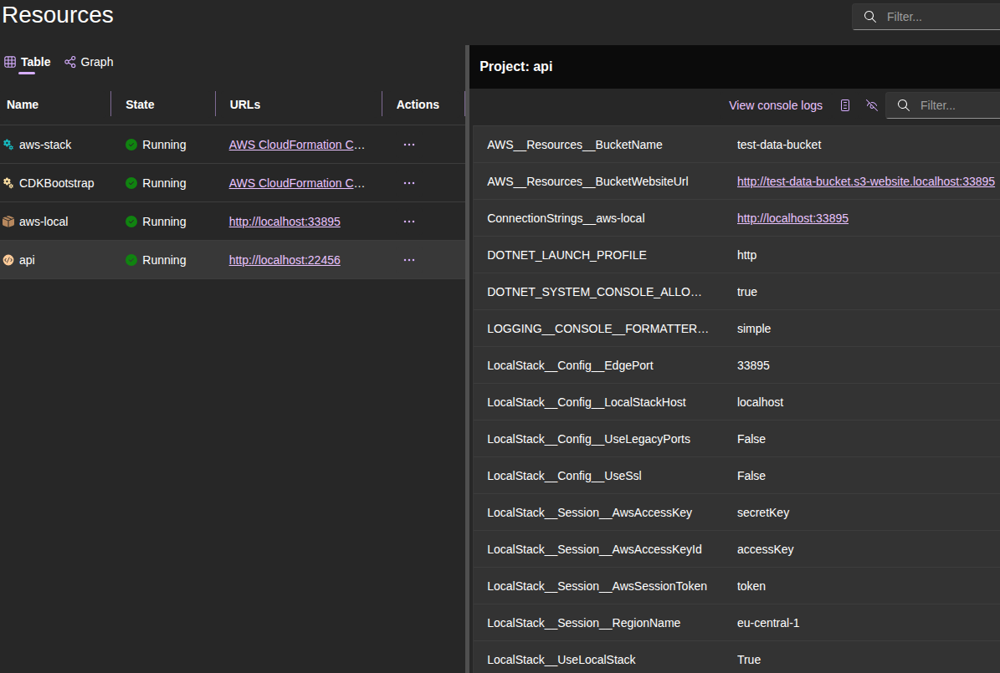

Developing a .NET application that uses AWS services presents several challenges. Either we're constantly hitting real AWS and watching our bill climb, or we're mocking everything and wondering if our code actually works. Teams often share dev environments, stepping on each other's data and debugging sessions. Developers frequently get stuck waiting for the "dev environment" to be free while someone else is testing their integration. .NET Aspire helps with microservice orchestration, but it doesn't solve the AWS development problem.

That's where [LocalStack](https://www.localstack.cloud/) comes in. Think of it as AWS running on our computer - S3, Lambda, DynamoDB, SQS, SNS, etc. The community edition is free and covers almost everything needed for typical development. No more spinning up separate AWS environments for each developer or dealing with resource cleanup across multiple accounts. Plus, we get faster feedback loops, can work offline, and can reset entire environment with a simple container restart.

In this article, we'll build a practical example that many developers encounter: an API service that uploads files to Amazon S3 and serves them via static website hosting. Similar pattern appears everywhere: profile picture uploads, document storage, media galleries, etc. We'll configure everything through .NET Aspire and LocalStack, so the same code works locally and in production without changes.

Before diving into the configuration, let's make sure our starting point is clear. We have a .NET Aspire application with one API service. The service exposes HTTP endpoints. Our solution structure looks like this (standard Aspire layout):
```bash
- AppHost - the Aspire host project
  - Program.cs - Aspire host entry point
  - appsettings.json - Aspire host configuration file
  - other Aspire host files...
- Api
  - Program.cs - API service entry point
  - appsettings.json - API service configuration file
  - other API service files...
- ServiceDefaults - common service configuration
  - Extensions.cs - common service extensions
```

`AppHost/Program.cs`:
```csharp
var builder = DistributedApplication.CreateBuilder(args);

builder.AddProject<Projects.Api>("api")
    .WithHttpHealthCheck("/health");

await builder.Build().RunAsync();
```

`Api/Program.cs`:
```csharp
var builder = WebApplication.CreateBuilder(args);

builder.AddServiceDefaults();

var app = builder.Build();

app.MapDefaultEndpoints();

// Health check endpoint
app.MapGet("/health", () => "Healthy");

app.Run();
```

Having this structure in place, we can now enhance the AppHost to integrate LocalStack and AWS services. First, we need to add the necessary Aspire LocalStack package to our AppHost project. In the `AppHost.csproj` file, add the following package reference:

```xml
<PackageReference Include="LocalStack.Aspire.Hosting" />
```

This package includes everything: LocalStack container management, AWS CDK integration, and CloudFormation orchestration.

Next, we need to configure the AWS SDK by adding a shared AWS configuration context:

```csharp
var awsConfig = builder.AddAWSSDKConfig()
    .WithProfile("default")
    .WithRegion(RegionEndpoint.EUCentral1);
```

The profile leverages AWS credential chains - local development can use AWS CLI profiles, while production uses IAM roles. The region specification ensures correct endpoints. We can make this more flexible with configuration:

```csharp
var awsConfig = builder.AddAWSSDKConfig()
    .WithProfile(builder.Configuration["AWS:Profile"] ?? "default")
    .WithRegion(RegionEndpoint.GetBySystemName(builder.Configuration["AWS:Region"] ?? "eu-central-1"));
```

Next, we need to set up LocalStack itself. We'll tell Aspire to manage a LocalStack container for us, configure its lifetime, and set logging levels for debugging:

```csharp
var awsLocal = builder.AddLocalStack("aws-local", // Name of the LocalStack instance
    awsConfig: awsConfig, // Link to AWS config created above
    configureContainer: c => // Configure LocalStack container options
    {
        c.Lifetime = ContainerLifetime.Session; // Reset container on app restart
        c.DebugLevel = 1; // Enable detailed logging
        c.LogLevel = LocalStackLogLevel.Debug; // Show debug information
    });
```

Key settings here:
- **Lifetime**:
    - `Session`: container resets every time we restart the app (default for testing)
    - `Persistent`: container survives app restarts, keeping our data
- **LogLevel**: see exactly what's happening with AWS calls
- **DebugLevel**: `1` - detailed request/response logging for troubleshooting

The persistent lifetime is important; we don't want to recreate S3 buckets every time we restart debugging. While Session lifetime is useful for testing setups, Persistent lifetime is better for day-to-day development.

The important part here is the AppHost configuration file. `AddLocalStack` will use the `LocalStack:UseLocalStack` setting to determine whether it should run in local mode. It looks for this setting in our configuration (`appsettings.json`, environment variable `LocalStack__UseLocalStack`, etc.). So in `AppHost/appsettings.json`, we can add:

```json
{
  "LocalStack": {
    "UseLocalStack": true
  }
}
```

Without this setting, LocalStack integration is disabled, and our services will try to connect to real AWS. This approach makes it easy to switch between local development and production without code changes.

After that, we can start defining AWS infrastructure. We can define AWS infrastructure as code and have it work with both LocalStack and real AWS. We'll use the AWS CDK (Cloud Development Kit) for this. Think of it as a way to write our infrastructure using familiar programming languages instead of YAML or JSON. CDK lets us define AWS resources like S3 buckets, SQS queues, or Lambda functions using C# classes, complete with IntelliSense, type safety, and all the benefits of a real programming language. When we build our CDK code, it generates CloudFormation templates that AWS (or LocalStack) can deploy.

```csharp
var awsStack = builder.AddAWSCDKStack("aws-stack", s => new AwsStack(s))
    .WithReference(awsConfig); // Link to AWS configuration

var awsStackOutputs = AwsStack.Outputs.Add(awsStack); // Get typed access to stack outputs
```

`AwsStack` is a custom class where we define AWS resources. To define the actual infrastructure, here's how we can create an Amazon S3 bucket with website hosting:

```csharp
public sealed class AwsStack : Amazon.CDK.Stack
{
    // Expose the S3 bucket as a property for output references
    public IBucket Bucket { get; }

    public AwsStack(Constructs.Construct scope)
        : base(scope, "bucket")
    {
        // Create S3 bucket with website hosting enabled
        Bucket = new Bucket(this,
            "bucket",
            new BucketProps
            {
                BucketName = "test-data-bucket",
                WebsiteIndexDocument = "index.html" // Enable static website hosting
            });

        // Allow public read access for static website hosting
        Bucket.AddToResourcePolicy(new PolicyStatement(new PolicyStatementProps
        {
            Actions = ["s3:GetObject"], // Allow public read access to objects
            Effect = Effect.ALLOW, // Allow access
            Principals = [new AnyPrincipal()], // Anyone can access
            Resources = [Bucket.ArnForObjects("*")] // All objects in the bucket
        }));
    }
    
    // The Outputs class provides type-safe access to stack resources.
    // Instead of handling raw strings in Program.cs, this gives compile-time validation
    // and prevents typos from becoming runtime errors.
    public sealed class Outputs(IResourceBuilder<IStackResource> stack)
    {
        // Output reference for the bucket name
        public StackOutputReference BucketName => stack.GetOutput(nameof(BucketName));

        // Output reference for the bucket website URL
        public StackOutputReference BucketWebsiteUrl => stack.GetOutput(nameof(BucketWebsiteUrl));

        // Method to add outputs to the stack
        public static Outputs Add(IResourceBuilder<IStackResource<AwsStack>> stack)
        {
            stack.AddOutput(nameof(BucketName), s => s.Bucket.BucketName);
            stack.AddOutput(nameof(BucketWebsiteUrl), s => s.Bucket.BucketWebsiteUrl);
            return new Outputs(stack);
        }
    }
}
```

The bucket configuration sets up static website hosting with public read access. The resource policy allows public access to objects while keeping the bucket itself private. Similarly, we can define other AWS resources as needed. For example, for Amazon SQS queues, we can call `new Queue(this, "queue", new QueueProps { ... })` and expose outputs like `QueueUrl` and/or `QueueArn`. For Amazon DynamoDB tables, we can define `new Table(this, "table", new TableProps { ... })` and expose outputs like `TableName`.

Once the infrastructure is defined, we can reference these resources in our services. Here's how to configure an API service to use the Amazon S3 bucket we created:

```csharp
var apiService = builder.AddProject<Projects.ApiService>("api")
    .WithHttpHealthCheck("/health") // Configure health check endpoint
    .WithReference(awsStack) // Reference the AWS stack for automatic configuration
    .WithEnvironment("Storage__BucketName", awsStackOutputs.BucketName) // Inject bucket name as config
    .WithEnvironment("Storage__PublicBaseUrl", awsStackOutputs.BucketWebsiteUrl); // Inject bucket URL as config
```

The `WithEnvironment(...)` calls inject these values as environment variables. `Storage__BucketName` becomes `Storage:BucketName` in our service's configuration.

It's also important to note that `WithReference(awsStack)` will automatically inject AWS resource outputs under the `AWS__Resources__*` configuration section, so we can access them directly as well. However, providing explicit configuration like `Storage:BucketName` in the service is often preferable to relying on generic output access. This approach also decouples our service configuration from the underlying infrastructure implementation, making it easier to change infrastructure without affecting service code.

Just before building the host, we need to enable LocalStack integration:

```csharp
// Enable LocalStack integration for all AWS resources
builder.UseLocalStack(awsLocal);
```

This one line does a lot of heavy lifting. It configures all AWS resources in the application to use the specified LocalStack instance, automatically detects CloudFormation templates and CDK stacks, and handles CDK bootstrap if needed. This method scans all resources in the application and automatically configures AWS resources and projects that reference AWS resources to use LocalStack for local development. It:
- Detects all CloudFormation templates and CDK stack resources
- Creates a CDK bootstrap resource automatically if CDK stacks are present
- Configures all AWS resources to use LocalStack endpoints
- Sets up proper dependency ordering for CDK bootstrap
- Automatically configures projects that reference AWS resources
- Adds annotation tracking to prevent duplicate configuration

Here's where it gets really interesting. When we call `WithReference(awsStack)` and enable LocalStack, Aspire automatically injects configuration into our services. We don't have to manage any of this ourselves.

Our service gets all these environment variables automatically:

**LocalStack Configuration (Example)**:
```toml
LocalStack__UseLocalStack = True
LocalStack__Config__EdgePort = 33895
LocalStack__Config__LocalStackHost = localhost
LocalStack__Config__UseLegacyPorts = False
LocalStack__Config__UseSsl = False
LocalStack__Session__AwsAccessKey = secretKey
LocalStack__Session__AwsAccessKeyId = accessKey
LocalStack__Session__AwsSessionToken = token
LocalStack__Session__RegionName = eu-central-1
```

**AWS Resource References (Example)**:
```toml
AWS__Resources__ProfileBucketName = test-data-bucket
AWS__Resources__ProfileBucketWebsiteUrl = http://test-data-bucket.s3-website.localhost:33895
```

**Application Configuration (Example)**:
```toml
Storage__BucketName = test-data-bucket
Storage__PublicBaseUrl = http://test-data-bucket.s3-website.localhost:33895
```

This maps to a equivalent JSON configuration structure:

```json
{
  "LocalStack": {
    "UseLocalStack": true,
    "Config": {
      "EdgePort": 33895,
      "LocalStackHost": "localhost",
      "UseLegacyPorts": false,
      "UseSsl": false
    },
    "Session": {
      "AwsAccessKey": "secretKey",
      "AwsAccessKeyId": "accessKey", 
      "AwsSessionToken": "token",
      "RegionName": "eu-central-1"
    }
  },
  "AWS": {
    "Resources": {
      "ProfileBucketName": "test-data-bucket",
      "ProfileBucketWebsiteUrl": "http://test-data-bucket.s3-website.localhost:33895"
    }
  },
    "Storage": {
    "BucketName": "test-data-bucket",
    "PublicBaseUrl": "http://test-data-bucket.s3-website.localhost:33895"
  }
}
```

It's also interesting that LocalStack handles URL rewriting for Amazon S3 website endpoints automatically. When we access, for example, `http://test-data-bucket.s3-website.localhost:33895`, LocalStack knows to route this to the correct S3 bucket in the LocalStack container. So if application code uploads an object to S3 and then constructs a URL using the bucket's website URL, it will work seamlessly with LocalStack without any additional configuration. Similarly, we can use Amazon CloudFront in front of S3 by creating a [Distribution object](https://aws-cdk.com/deploying-a-static-website-using-s3-and-cloudfront), and that will work with LocalStack as well.

So, after all this setup, the final version of `Program.cs` in our AppHost might looks like this:

```csharp
using Amazon;
using Amazon.CDK.AWS.IAM;
using Amazon.CDK.AWS.S3;
using Aspire.Hosting.AWS.CDK;
using Aspire.Hosting.AWS.CloudFormation;
using Aspire.Hosting.LocalStack.Container;

var builder = DistributedApplication.CreateBuilder(args);

// AWS Resources

var awsConfig = builder.AddAWSSDKConfig()
    .WithProfile("default")
    .WithRegion(RegionEndpoint.EUCentral1);

var awsLocal = builder.AddLocalStack("aws-local",
    awsConfig: awsConfig,
    configureContainer: c =>
    {
        c.Lifetime = ContainerLifetime.Persistent;
        c.DebugLevel = 1;
        c.LogLevel = LocalStackLogLevel.Debug;
    });

var awsStack = builder.AddAWSCDKStack("aws-stack", s => new AwsStack(s))
    .WithReference(awsConfig);
var awsStackOutputs = AwsStack.Outputs.Add(awsStack);

// Services

builder.AddProject<Projects.Api>("api")
    .WithHttpHealthCheck("/health")
    .WithReference(awsStack)
    .WithEnvironment("Storage__BucketName", awsStackOutputs.BucketName)
    .WithEnvironment("Storage__PublicBaseUrl", awsStackOutputs.BucketWebsiteUrl);

// Run

builder.UseLocalStack(awsLocal);

await builder.Build().RunAsync();

public sealed class AwsStack : Amazon.CDK.Stack
{
    public IBucket Bucket { get; }

    public AwsStack(Constructs.Construct scope)
        : base(scope, "bucket")
    {
        Bucket = new Bucket(this,
            "bucket",
            new BucketProps
            {
                BucketName = "test-data-bucket",
                AccessControl = BucketAccessControl.PRIVATE,
                WebsiteIndexDocument = "index.html" // Enable static website hosting
            });

        Bucket.AddToResourcePolicy(new PolicyStatement(new PolicyStatementProps
        {
            Actions = ["s3:GetObject"],
            Effect = Effect.ALLOW,
            Principals = [new AnyPrincipal()],
            Resources = [Bucket.ArnForObjects("*")]
        }));
    }
    
    public sealed class Outputs(IResourceBuilder<IStackResource> stack)
    {
        public StackOutputReference BucketName => stack.GetOutput(nameof(BucketName));
    
        public StackOutputReference BucketWebsiteUrl => stack.GetOutput(nameof(BucketWebsiteUrl));

        public static Outputs Add(IResourceBuilder<IStackResource<AwsStack>> stack)
        {
            stack.AddOutput(nameof(BucketName), s => s.Bucket.BucketName);
            stack.AddOutput(nameof(BucketWebsiteUrl), s => s.Bucket.BucketWebsiteUrl);
            return new Outputs(stack);
        }
    }
}
```

And now when we run the AppHost, Aspire will start LocalStack, deploy CDK stack to it, and inject all the necessary configuration into API service. Here is a screenshot of the Aspire dashboard showing LocalStack running and the CDK stack deployed:



Now the AppHost is configured. It's time to set up the service itself to use the AWS SDK with LocalStack. First, add the necessary package reference to the service project file `Api.csproj`:

```xml
<PackageReference Include="AWSSDK.S3" />
<PackageReference Include="LocalStack.Client" />
<PackageReference Include="LocalStack.Client.Extensions" />
```

Then, in the API service `Program.cs`, we add LocalStack integration and register the S3 client:

```csharp
// Configure LocalStack and AWS SDK integration
builder.Services.AddLocalStack(builder.Configuration); // Read LocalStack config from Aspire
builder.Services.AddDefaultAWSOptions(builder.Configuration.GetAWSOptions()); // Configure AWS SDK
builder.Services.AddAwsService<IAmazonS3>(); // Register S3 client with dependency injection
```

That's it. The `AddLocalStack(...)` method reads all the configuration Aspire injected and sets up the AWS SDK to talk to LocalStack. The S3 client now points to LocalStack automatically. In addition, the AWS SDK client registration `AddAwsService<IAmazonS3>()` uses the configured AWS options, which now include LocalStack endpoints.

Here's how the simple API service code looks (we have two endpoints: one for uploading files to Amazon S3 and another for downloading files from S3; this is simple test functionality to demonstrate S3 integration):

```csharp
// SIMPLIFIED TESTING CODE - DO NOT USE IN PRODUCTION
// THIS IS FOR INTEGRATION DEMONSTRATION PURPOSES ONLY

using Amazon.S3;
using Amazon.S3.Model;
using LocalStack.Client.Extensions;
using Microsoft.Extensions.Options;

var builder = WebApplication.CreateBuilder(args);

builder.AddServiceDefaults();

// Configure LocalStack and AWS SDK
builder.Services.AddLocalStack(builder.Configuration);
builder.Services.AddDefaultAWSOptions(builder.Configuration.GetAWSOptions());
builder.Services.AddAwsService<IAmazonS3>();

// Register our storage configuration
builder.Services.Configure<StorageOptions>(builder.Configuration.GetSection("Storage"));

var app = builder.Build();

app.MapDefaultEndpoints();

// Health check endpoint
app.MapGet("/health", () => "Healthy");

// Upload endpoint
app.MapPost("/upload", async (
    IFormFile file,
    IAmazonS3 s3Client,
    IOptions<StorageOptions> storageOptions) =>
{
    var bucketName = storageOptions.Value.BucketName;
    var key = file.FileName; // Use original filename as S3 key for simplicity (UNSAFE for production)

    await using var stream = file.OpenReadStream();
    await s3Client.PutObjectAsync(new PutObjectRequest
    {
        BucketName = bucketName,
        Key = key,
        InputStream = stream,
        ContentType = file.ContentType
    });
    
    return Results.Ok(new
    {
        Url = new Uri(storageOptions.Value.PublicBaseUrl, key)
    });
}).DisableAntiforgery(); // Disable antiforgery for simplicity in this example

// Download endpoint
app.MapGet("/download/{key}", async (
    string key,
    IAmazonS3 s3Client,
    IOptions<StorageOptions> storageOptions) =>
{
    var bucketName = storageOptions.Value.BucketName;

    try
    {
        var response = await s3Client.GetObjectAsync(bucketName, key);
        return Results.File(response.ResponseStream, response.Headers["Content-Type"], key);
    }
    catch (AmazonS3Exception ex) when (ex.StatusCode == System.Net.HttpStatusCode.NotFound)
    {
        return Results.NotFound();
    }
});

app.Run();

// Storage configuration class
// Maps to Storage section in configuration:
// Storage:BucketName and Storage:PublicBaseUrl
public sealed class StorageOptions
{
    public string BucketName { get; init; } = null!;
    public Uri PublicBaseUrl { get; init; } = null!;
}
```

The beauty here is that the LocalStack client automatically falls back to real AWS when LocalStack isn't enabled. We don't need conditional registration - just use `AddAwsService<...>()` everywhere and let the configuration decide where calls go. The LocalStack Client uses these injected settings (`LocalStack__` from above, especially `LocalStack__UseLocalStack`) to route requests to LocalStack when enabled, or to real AWS otherwise.

So now we can run our Aspire application again and test the API service. We can use tools like Postman or curl to upload and download files. Since LocalStack is running, all Amazon S3 operations happen locally without touching real AWS. We can even use the AWS CLI to inspect the LocalStack S3 bucket. In my case it looks like this:

```bash
# Upload a file using curl
curl -v "http://localhost:22456/upload" -F "file=@index.html"
  # *   Trying 127.0.0.1:22456...
  # * Connected to localhost (127.0.0.1) port 22456 (#0)
  # > POST /upload HTTP/1.1
  # > Host: localhost:22456
  # > User-Agent: curl/7.87.0
  # > Accept: */*
  # > Content-Length: 326
  # > Content-Type: multipart/form-data; boundary=------------------------90474ff5b4693aae
  # > 
  # * We are completely uploaded and fine
  # * Mark bundle as not supporting multiuse
  # < HTTP/1.1 200 OK
  # < Content-Type: application/json; charset=utf-8
  # < Date: Wed, 02 Nov 2025 16:44:05 GMT
  # < Server: Kestrel
  # < Transfer-Encoding: chunked
  # < 
  # * Connection #0 to host localhost left intact
  # {"url":"http://test-data-bucket.s3-website.localhost:33895/index.html"}%  

# List objects in the S3 bucket using AWS CLI
aws --endpoint-url="http://localhost:33895" s3 ls s3://test-data-bucket
  # 2025-11-02 17:44:05        139 index.html

# Download the file using curl
curl -v "http://localhost:22456/download/index.html" -o downloaded_index.html
```

Useful links:
- [LocalStack](https://github.com/localstack/localstack)
- [.NET Aspire Integrations for LocalStack](https://github.com/localstack-dotnet/dotnet-aspire-for-localstack)
- [LocalStack .NET Client](https://github.com/localstack-dotnet/localstack-dotnet-client)
- [Integrating AWS with .NET Aspire](https://aws.amazon.com/blogs/developer/integrating-aws-with-net-aspire/)
- [Working with the AWS CDK in C#](https://docs.aws.amazon.com/cdk/v2/guide/work-with-cdk-csharp.html)
- [LocalStack Provisioning Examples](https://github.com/localstack-dotnet/dotnet-aspire-for-localstack/tree/master/playground/provisioning)
